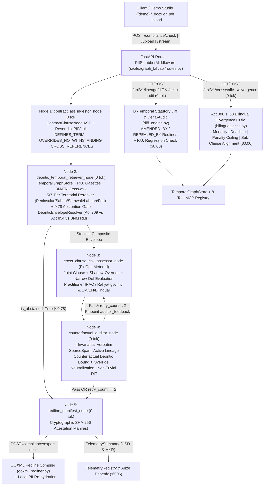

# `lexgraph-lah` — Deterministic Multi-Regime Legal Compliance, Counterfactual Redline & FinOps Engine

[](https://github.com/Kearskill/lexgraph-lah/actions/workflows/ci.yml)
[](https://www.python.org/)
[](https://github.com/astral-sh/uv)
[](https://fastapi.tiangolo.com/)
[](https://langchain-ai.github.io/langgraph/)
[](./LICENSE)

**`lexgraph-lah`** is a deterministic multi-agent regulatory compliance, bi-temporal statutory redline diffing, Act 388 bilingual divergence auditing, contract AST trap-detection, and Track-Changes `.docx` redline compiler engineered for overlapping Malaysian statutory regimes: **PDPA 2010 [Act 709] & PDPA (Amendment) Act 2024 [Act A1727]**, **Cyber Security Act 2024 [Act 854] & P.U. (A) 220/2024**, **Bank Negara Malaysia RMiT**, and **Interpretation Acts 1948 and 1967 [Act 388]**, alongside Malaysian constitutional, contractual, and 5-way East/West/Offshore territorial statutes (`Act 265`, `Sabah Cap. 67`, `Sarawak Cap. 76`, `Labuan Act 704`, `Act 136`, `Act 574`).

---

## Core Capabilities

1. **Zero-Token Multi-Regime Deontic Conflict Solver (`DeonticEnvelopeResolver`):**
   - Resolves point-in-time statutes and bi-temporal `P.U. (A)` / `P.U. (B)` subsidiary gazettes in `O(V + E)` (`0` LLM tokens) across **Act 709** (`72h` breach notice), **Act 854 & P.U. (A) 220/2024** (`6h` NCII initial particulars, `14d` full report, effective `2024-08-26`), and **BNM RMiT** (`1h` critical incident escalation, cloud exit plan & regulator audit rights).
   - Synthesizes the **Strictest Composite Statutory Envelope** with inter-regime conflict deltas and full statutory provenance chains.
2. **Zero-Token Bi-Temporal Statutory Redline Diff & Contract Delta-Audit (`diff_engine.py`):**
   - Deterministically compares any statutory or `P.U.` subsidiary provision between `from_date` and `to_date` across `AMENDED_BY`, `SUPERSEDED_BY`, and `REPEALED_BY` chains (`diff_statute_lineage` / `StatutoryVersionDiff`), emitting `SourceSpan`-grounded added/removed/modified clause diffs and gazette transition dates at `$0.00 USD / RM 0.00 MYR`.
   - Evaluates **Contract Delta-Audit** regressions (`evaluate_contract_delta_impact` / `ContractDeltaAuditResponse`) to detect whether an agreement compliant at `from_date` becomes non-compliant at `to_date` due to intervening amendments or `P.U.` gazette commencements (e.g., pre-2025 PDPA vs. Act A1727 / `P.U. (A) 220/2024`), protected by pre-flight Malaysian PII scrubbing.
3. **Act 388 Bilingual Divergence & Authoritative Text Critic (`bilingual_critic.py`):**
   - Under Malaysia's **Interpretation Acts 1948 and 1967 [Act 388], s. 63**, deterministically audits paired Bahasa Melayu (`Seksyen`) and English (`Section`) `SourceSpan` nodes (`audit_bilingual_divergence` / `BilingualDivergenceReport`, `$0.00 USD`) for deontic modality mismatches (`hendaklah`/`wajib` vs. `may`), numeric/deadline discrepancies, `RM` penalty ceiling differences, and missing sub-clauses/provisos, surfacing authoritative language precedence.
4. **Intra-Contract Clause AST, Shadow-Override Trap Detector & Reversible PII Vault:**
   - Parses `.docx` (OOXML XML), `.pdf` (compressed stream/text), and raw BM/EN/mixed contracts into structural `ContractClauseNode`s with immutable hierarchical `SourceSpan`s (`pdf_page`, `paragraph_idx`, `start_char`, `end_char`, SHA-256).
   - Scrubs Malaysian NRIC, Passport, Phone, Email, and SSM numbers pre-flight (`<50ms` gate) via `PIIScrubberMiddleware` and a per-request **Reversible Ephemeral Token Vault** (`[MYKAD_01]`, `[PASSPORT_01]`, `[SSM_REG_01]`, `[PHONE_MY_01]`) so zero raw PII ever reaches Gemini prompts or OTel spans, while supporting local re-hydration during downloadable `.docx` compilation.
   - Builds a typed **Intra-Contract Dependency Graph** (`DEFINES_TERM`, `OVERRIDES_NOTWITHSTANDING`, `CROSS_REFERENCES`) flagging **Narrow Definition Traps** and hostile EN/BM priority overrides (`"Notwithstanding Clause..."`, `"Walau apa pun yang terkandung dalam Klausa..."`).
5. **5-Node Counterfactual Redline LangGraph (`MAX_RETRIES = 2`):**
   - **`contract_ast_ingestor_node`** (`0` tokens) -> **`deontic_temporal_retriever_node`** (`0` tokens, `0.78` Abstention Gate + 5/7-tier Malaysian authority & territorial reranker) -> **`cross_clause_risk_assessor_node`** (LLM / deterministic offline, Persona `PRACTITIONER` IRAC vs `RAKYAT` `gov.my`, BM/EN/Bilingual) -> **`counterfactual_auditor_node`** (`0` tokens, 4-invariant deterministic critic: Verbatim `SourceSpan`, Active Lineage Provenance, Counterfactual Deontic Envelope Satisfaction + Shadow Override neutralization, and Non-Trivial Mutation) -> **`redline_manifest_node`** (`0` tokens, cryptographic SHA-256 `ComplianceAttestationManifest`).
6. **Bilingual (BM <-> EN) Crosswalk, Judicial Lineage & 5-Way Territorial Isolation:**
   - Links parallel Bahasa Melayu (`Seksyen`) and English (`Section`) statutory nodes via bidirectional `BM_EN_EQUIVALENT`, `HAS_TRANSLATION`, and `AUTHORITATIVE_TEXT` edges, traverses judicial treatment (`INTERPRETS`, `APPLIES`, `DISTINGUISHES`, `OVERRULES`), and isolates Peninsular (`Act 265`), Sabah (`Cap. 67`), Sarawak (`Cap. 76`), Labuan (`Act 704`), and Federal Territories scopes.
7. **Native OOXML `.docx` Track-Changes Compiler & Live SSE Streaming:**
   - Emits genuine Microsoft Word Track Changes `.docx` packages (`<w:trackRevisions/>`, `<w:del>`, `<w:ins author="lexgraph-lah">`, and `<w:comment>` statutory/gazette/FinOps annotations) and streams real-time 5-node LangGraph execution + USD/MYR burn ticker over SSE (`POST /compliance/stream`).
8. **8-Tool MCP Server & Dual-Layer Cytoscape.js + Time-Travel Redline Console:**
   - Exposes Act 709 scanning, bilingual point-in-time retrieval, PII scrubbing, deontic envelope resolution, contract shadow-override detection, end-to-end redlining, bi-temporal statutory diffing, and Act 388 bilingual divergence auditing via REST/MCP (`/api/v1/mcp/tools`, `/api/v1/mcp/call`) alongside a Dual-Layer Contract AST + Time-Travel Statutory Redline Explorer (`/dashboard`) and Act 388 bilingual drawer (`/demo`).

---

## System Architecture



### Core Modules (`src/lexgraph_lah/`)

| Module | Responsibility |
| :--- | :--- |
| [`src/lexgraph_lah/schemas/domain.py`](./src/lexgraph_lah/schemas/domain.py) | Strict Pydantic v2 domain models: `StatutoryVersionDiff`, `ContractDeltaAuditResponse`, `BilingualDivergenceReport`, `DeonticConstraint`, `CompositeDeonticEnvelope`, `ContractASTGraph`, `ShadowOverrideTrap`, `NarrowDefinitionTrap`, `ComplianceAttestationManifest`, `SourceSpan`, `StatutoryNode`, `ClauseAudit`, `ContractAuditResponse`, `PointInTimeResearchResponse`. |
| [`src/lexgraph_lah/schemas/state.py`](./src/lexgraph_lah/schemas/state.py) | `AgentState` `TypedDict` with additive `Annotated[int, operator.add]` token reducers and 5-node state payloads. |
| [`src/lexgraph_lah/graph/temporal_store.py`](./src/lexgraph_lah/graph/temporal_store.py) | `TemporalGraphStore` & parameterized Cypher builders (`build_point_in_time_cypher`, `build_upsert_amendment_cypher`, `build_repeal_cypher`), seeding Act 709, Act 854 & `P.U. (A) 220/2024`, BNM RMiT, `P.U. (A) 342/2024`, `P.U. (B) 512/2024`, Act 388 s. 63, Act 265, Sabah Cap. 67, Sarawak Cap. 76, Labuan Act 704, Act 136, Act 574, and Federal/COA/HC cases. |
| [`src/lexgraph_lah/graph/diff_engine.py`](./src/lexgraph_lah/graph/diff_engine.py) | Zero-token bi-temporal statutory redline diffing (`diff_statute_lineage`) and Contract Delta-Audit regression engine (`evaluate_contract_delta_impact`). |
| [`src/lexgraph_lah/graph/bilingual_critic.py`](./src/lexgraph_lah/graph/bilingual_critic.py) | Zero-token Act 388 s. 63 Bilingual Divergence Critic (`audit_bilingual_pair`, `audit_bilingual_divergence`) detecting deontic modality, deadline, `RM` penalty, and sub-clause discrepancies. |
| [`src/lexgraph_lah/graph/deontic_solver.py`](./src/lexgraph_lah/graph/deontic_solver.py) | `DeonticEnvelopeResolver`: zero-token $O(V + E)$ strictest-bound solver across colliding Malaysian regulatory regimes. |
| [`src/lexgraph_lah/graph/bilingual_router.py`](./src/lexgraph_lah/graph/bilingual_router.py) & [`reranker.py`](./src/lexgraph_lah/graph/reranker.py) | BM/EN/code-switched query expansion, 5-way territorial isolation, `0.78` Abstention Gate, and 5/7-tier Malaysian authority reranker. |
| [`src/lexgraph_lah/graph/ingestion.py`](./src/lexgraph_lah/graph/ingestion.py) | Structure-aware statute splitter (`Act -> Part -> Chapter -> Section -> Subsection -> Proviso -> Illustration`) and `BilingualCrosswalkResolver`. |
| [`src/lexgraph_lah/ingestion/contract_ast.py`](./src/lexgraph_lah/ingestion/contract_ast.py) | `.docx` / `.pdf` / raw text extractor, Intra-Contract Dependency Graph (`DEFINES_TERM`, `OVERRIDES_NOTWITHSTANDING`, `CROSS_REFERENCES`), and EN/BM trap detection. |
| [`src/lexgraph_lah/ingestion/ooxml_redliner.py`](./src/lexgraph_lah/ingestion/ooxml_redliner.py) | Native Microsoft Word OOXML Track-Changes `.docx` compiler (`<w:del>`, `<w:ins>`, `<w:comment>`, `<w:trackRevisions/>`) with optional local PII re-hydration. |
| [`src/lexgraph_lah/middleware/pii_scrubber.py`](./src/lexgraph_lah/middleware/pii_scrubber.py) | Pre-flight `<50ms` Malaysian PII Scrubber Middleware (`PIIScrubberMiddleware`) & per-request `ReversiblePIIVault`. |
| [`src/lexgraph_lah/compliance/pdpa_scanner.py`](./src/lexgraph_lah/compliance/pdpa_scanner.py) | Deterministic Act 709 PDPA gap scanner with Practitioner IRAC, Rakyat `gov.my` guidance, and Act 388 divergence warnings. |
| [`src/lexgraph_lah/agents/graph.py`](./src/lexgraph_lah/agents/graph.py) | 5-node bounded LangGraph state machine (`contract_ast_ingestor` -> `deontic_temporal_retriever` -> `cross_clause_risk_assessor` -> `counterfactual_auditor` -> `redline_manifest`). |
| [`src/lexgraph_lah/mcp/tools.py`](./src/lexgraph_lah/mcp/tools.py) | 8-tool MCP registry & async/sync dispatchers (`diff_statutory_versions`, `audit_bilingual_crosswalk`, etc.). |
| [`src/lexgraph_lah/api/routes.py`](./src/lexgraph_lah/api/routes.py) | FastAPI REST, SSE, multipart upload, `.docx` export, statutory diff/divergence APIs, `/demo` Studio UI, and Dual-Layer `/dashboard`. |
| [`src/lexgraph_lah/telemetry/cost_tracker.py`](./src/lexgraph_lah/telemetry/cost_tracker.py) & [`tracer.py`](./src/lexgraph_lah/telemetry/tracer.py) | Deterministic USD/MYR FinOps calculator (`assert_within_budget < $0.005 USD`) and Arize Phoenix OpenTelemetry instrumentation. |

---

## Quickstart

### Option 1: Local Development with `uv`

```bash
git clone https://github.com/Kearskill/lexgraph-lah.git
cd lexgraph-lah
cp .env.example .env
uv sync --all-extras --dev --frozen
uv run lexgraph-lah
```

### Option 2: Docker Compose (API + Arize Phoenix)

```bash
cp .env.example .env
docker compose up --build
```

### Interactive UIs & Consoles

| View | URL | Description |
| :--- | :--- | :--- |
| **Interactive Studio UI** | [`http://localhost:8000/`](http://localhost:8000/) (or `/demo`) | Multi-Regime selector chips, `.docx`/`.pdf` drag-and-drop upload, 5-node live SSE stepper + USD/MYR burn ticker, Shadow Override Trap alerts, Bilingual BM/EN Drawer with **Act 388 s. 63 alignment & divergence badges**, Practitioner/Rakyat persona density toggle, and Track-Changes `.docx` download. |
| **Dual-Layer Graph & FinOps Console** | [`http://localhost:8000/dashboard`](http://localhost:8000/dashboard) | Interactive Cytoscape.js graph with **Dual-Layer Graph Mode** and **Time-Travel Statutory Redline Explorer** (`from_date` <-> `to_date` Cytoscape `AMENDED_BY` / `REPEALED_BY` path highlighting + inline green/red clause diff at `$0.00`), Cypher viewer, and OTel span metrics. |
| **OpenAPI / Swagger Docs** | [`http://localhost:8000/docs`](http://localhost:8000/docs) | OpenAPI v3 schema for all compliance, deontic, diff, divergence, upload, SSE, export, lineage, and MCP endpoints. |
| **Arize Phoenix OTel UI** | [`http://localhost:6006`](http://localhost:6006) | Distributed OpenTelemetry trace inspection (when launched via Docker Compose). |

---

## API Contracts & MCP Tool Catalog

### Key REST & SSE Endpoints

| Endpoint | Method | Purpose |
| :--- | :--- | :--- |
| `/compliance/check` | `POST` | Runs the 5-node multi-regime audit (`regimes`, `as_of_date`, `territorial_scope`, `persona`, `language`) with SHA-256 FinOps cache support. |
| `/compliance/stream` | `POST` | Streams live SSE (`text/event-stream`) frames (`node_update`, `abstention_gate`, `counterfactual_diff`, `finops_tick`, `complete`). |
| `/compliance/upload` | `POST` | Multipart `.docx`, `.pdf`, or `.txt` upload endpoint with multi-regime AST trap detection and reversible PII scrubbing. |
| `/compliance/export-docx` | `POST` | Compiles and streams a Track-Changes `.docx` (`<w:del>`, `<w:ins>`, `<w:comment>`, `<w:trackRevisions/>`) with `X-LexGraph-Attestation-SHA256` and FinOps headers. |
| `/api/v1/lineage/diff` | `GET` / `POST` | Zero-token bi-temporal statutory redline diff across `AMENDED_BY` and `REPEALED_BY` chains between `from_date` and `to_date`. |
| `/api/v1/lineage/delta-audit` | `POST` | Zero-token Contract Delta-Audit detecting whether a contract compliant at `from_date` becomes non-compliant at `to_date` (PII-scrubbed). |
| `/api/v1/crosswalk/{node_id}/divergence` | `GET` | Zero-token Act 388 s. 63 Bilingual Divergence Critic inspecting paired BM/EN statutory `SourceSpan` nodes. |
| `/api/v1/crosswalk/divergence` | `POST` | Act 388 s. 63 Bilingual Divergence Critic for stored `node_id` or PII-scrubbed inline `en_text` vs. `bm_text` inputs. |
| `/api/v1/deontic/envelope` | `GET` | Zero-token `DeonticEnvelopeResolver` returning strictest composite bounds and inter-regime conflict deltas. |
| `/api/v1/compliance/scan` | `POST` | Deterministic pre-flight PII-scrubbed Act 709 compliance gap scanner with Act 388 divergence warnings. |
| `/api/v1/research/point-in-time` | `POST` | 4-stage bilingual point-in-time research with 7-tier court/statute authority breakdown and amendment timeline. |
| `/api/v1/provisions/{id}/lineage` | `GET` | Full chronological amendment history, BM/EN pair, and judicial treatment for a provision node. |
| `/api/v1/statutes/{node_id}/bilingual` | `GET` | Synchronized BM/EN statutory pair, `SourceSpan` provenance, and Act 388 divergence telemetry. |
| `/api/v1/retrieval/search` | `GET` | Bilingual hybrid search with 5-way territorial scope filtering and `0.78` Abstention Gate. |
| `/graph/nodes` | `GET` | Statutory topology + optional `include_contract_ast=true` Dual-Layer Contract AST overlay. |
| `/api/v1/mcp/tools` & `/api/v1/mcp/call` | `GET` / `POST` | Discovery and HTTP invocation for all 8 MCP tools. |

### MCP Tools (`src/lexgraph_lah/mcp/tools.py`)

1. `lexgraph_pdpa_compliance_scan`: Act 709 PDPA gap scan with pre-flight PII scrubbing and `SourceSpan` citations.
2. `lexgraph_point_in_time_search`: Bilingual BM/EN/code-switched statutory search with 5-tier reranking and `0.78` Abstention Gate.
3. `lexgraph_pii_scrub`: Deterministic `<50ms` Malaysian NRIC, Passport, Phone, Email, and SSM masking.
4. `resolve_deontic_envelope`: Zero-token strictest composite statutory envelope solver across Act 709, Act 854 (`P.U. (A) 220/2024`), and BNM RMiT.
5. `detect_contract_shadow_overrides`: Intra-Contract AST dependency graph builder detecting `DEFINES_TERM` narrow definitions and `OVERRIDES_NOTWITHSTANDING` EN/BM shadow traps.
6. `audit_and_redline_contract`: End-to-end 5-node multi-regime counterfactual audit and attestation manifest generator.
7. `diff_statutory_versions`: Zero-token bi-temporal statutory version redline diff (`from_date` <-> `to_date`) with optional Contract Delta-Audit regression check.
8. `audit_bilingual_crosswalk`: Zero-token Act 388 s. 63 Bilingual Divergence Critic inspecting BM/EN `SourceSpan` alignment across modality, deadlines, `RM` ceilings, and sub-clauses.

---

## Testing, Evaluation & Determinism Benchmark

### 1. Run Quality Gates & Offline-Safe Tests

```bash
uv run ruff check src/ tests/ evals/
uv run mypy src/ --ignore-missing-imports
uv run pytest -v
```

### 2. Run the 20-Scenario Determinism & FinOps Benchmark v2

`evals/run_benchmark.py` executes 20 Malaysian compliance scenarios across 3 repeated trials (`60` total evaluation runs), covering pre-2025 PDPA baselines, post-2025 PDPA Amendments, Act 854 `6h` counterfactual rejection/recovery, BNM RMiT `1h` tri-regime collisions, adversarial EN (`"Notwithstanding"`) / BM (`"Walau apa pun"`) shadow-override traps, `0.78` out-of-domain abstention rejection, 5-way territorial isolation (Peninsular, Sabah, Sarawak, Labuan, Federal), pre-flight Malaysian PII scrubbing, bi-temporal `P.U. (A) 220/2024` gazette transitions, zero-token statutory diff + Contract Delta-Audit, and Act 388 s. 63 bilingual divergence checks:

```bash
uv run python evals/run_benchmark.py --mode mock --trials 3
# Live Gemini evaluation (requires GEMINI_API_KEY in .env):
uv run python evals/run_benchmark.py --mode live --trials 3
```

| Metric | Observed (`--mode mock --trials 3`) | SLA Target | Status |
| :--- | :--- | :--- | :--- |
| **Scenarios x Trials** | `20 scenarios x 3 trials (60 runs)` | `>= 18 scenarios` | PASS |
| **Determinism Consistency (%)** | `100.00%` | `100.00%` | PASS |
| **Verdict Accuracy (%)** | `100.00%` | `>= 95.00%` | PASS |
| **Verbatim Citation Grounding (%)** | `100.00%` | `100.00%` | PASS |
| **Temporal Context Recall (%)** | `100.00%` | `100.00%` | PASS |
| **Temporal Contamination Rate (%)** | `0.00%` | `0.00%` | PASS |
| **Latency p50 / p95 (ms)** | `17.60 ms / 50.26 ms` | `< 5000.00 ms` | PASS |
| **Mean Tokens per Audit** | `703.5 tokens` | `< 15000 tokens` | PASS |
| **Mean Cost per Audit (USD & MYR)** | `$0.000177 USD / RM 0.000780 MYR` | `< $0.005000 USD` | PASS |

---

## License

Released under the [MIT License](./LICENSE). Copyright (c) 2026 Kearney Leith Julius.
