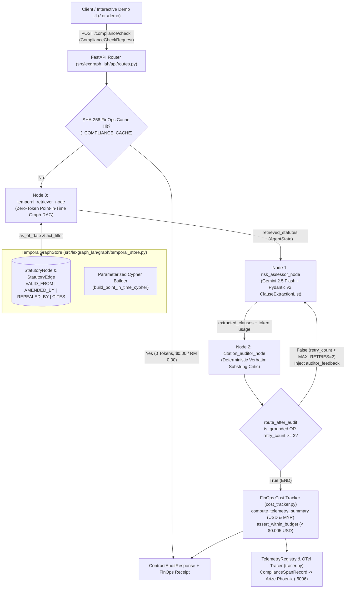

# `lexgraph-lah` — Deterministic Multi-Agent Legal Compliance & FinOps Engine

[](https://github.com/Kearskill/lexgraph-lah/actions/workflows/ci.yml)
[](https://www.python.org/)
[](https://github.com/astral-sh/uv)
[](https://fastapi.tiangolo.com/)
[](https://langchain-ai.github.io/langgraph/)
[](./LICENSE)

**`lexgraph-lah`** is a deterministic multi-agent regulatory and contractual compliance engine built for Malaysian statutory regimes (including the **Personal Data Protection Act 2010 (PDPA)** and the **PDPA (Amendment) Act 2024**). It combines **Point-in-Time Temporal Graph-RAG**, a **Zero-Hallucination Substring Verification Critic** orchestrated via **LangGraph**, **FinOps USD/MYR Token Cost Accounting**, and **OpenTelemetry (Arize Phoenix)** trace observability.

---

## Why `lexgraph-lah`? (Problem & Value Proposition)

Standard RAG pipelines fail in regulated legal and corporate compliance workflows for three reasons:

1. **Temporal & Statutory Contamination:** Auditing a 2024 contract against a 2025 statutory amendment produces false-positive compliance failures. `lexgraph-lah` resolves point-in-time statutes deterministically (`VALID_FROM`, `VALID_TO`, `AMENDED_BY`, `REPEALED_BY`, and multi-hop `CITES` edges) in `O(V + E)` **before** invoking the LLM—spending `0` tokens on superseded or post-dated legislation.
2. **Hallucinated Citations & Unbounded Agent Loops:** Generative models frequently paraphrase contract clauses or invent section references. `lexgraph-lah` pairs a structured Pydantic v2 extractor (`risk_assessor_node`) with a deterministic zero-cost substring critic (`citation_auditor_node`) inside a bounded self-correction loop (`MAX_RETRIES = 2`), guaranteeing character-for-character verbatim grounding without runaway retry loops.
3. **Opaque Token Spend in Multi-Currency Enterprise Environments:** Malaysian legal-tech and financial institutions budget in **MYR (Malaysian Ringgit)** while LLM APIs bill in **USD**. Every compliance run emits a deterministic **FinOps Receipt** (`TelemetrySummary`) tracking prompt/completion tokens, latency, retry overhead, and exact **USD + MYR** costs, backed by a SHA-256 semantic/exact-match cache (`$0.00` on repeat audits) and per-run SLA budget guardrails (`assert_within_budget`).

---

## System Architecture



### Core Components (`src/lexgraph_lah/`)

| Module | Responsibility |
| :--- | :--- |
| [`src/lexgraph_lah/schemas/domain.py`](./src/lexgraph_lah/schemas/domain.py) | Strict Pydantic v2 schemas: `StatutoryNode`, `StatutoryEdge`, `ClauseAudit`, `ClauseExtractionList`, `ComplianceCheckRequest`, `ContractAuditResponse`, `TelemetrySummary`. |
| [`src/lexgraph_lah/schemas/state.py`](./src/lexgraph_lah/schemas/state.py) | `AgentState` `TypedDict` with additive `Annotated[int, operator.add]` reducers for `prompt_tokens` and `completion_tokens` across bounded retries. |
| [`src/lexgraph_lah/graph/temporal_store.py`](./src/lexgraph_lah/graph/temporal_store.py) | `TemporalGraphStore` & parameterized Neo4j/Memgraph Cypher builders (`build_point_in_time_cypher`, `build_upsert_amendment_cypher`, `build_repeal_cypher`). |
| [`src/lexgraph_lah/agents/graph.py`](./src/lexgraph_lah/agents/graph.py) | Compiled LangGraph workflow (`temporal_retriever` $\rightarrow$ `risk_assessor` $\rightarrow$ `citation_auditor`) with `route_after_audit` (`MAX_RETRIES = 2`). |
| [`src/lexgraph_lah/telemetry/cost_tracker.py`](./src/lexgraph_lah/telemetry/cost_tracker.py) | Deterministic USD & MYR cost calculator (`compute_telemetry_summary`) and SLA guardrail (`assert_within_budget`, `BudgetExceededError`). |
| [`src/lexgraph_lah/telemetry/tracer.py`](./src/lexgraph_lah/telemetry/tracer.py) | `TelemetryRegistry` ring buffer and `arize-phoenix-otel` / `openinference-instrumentation-langchain` auto-instrumentation. |
| [`src/lexgraph_lah/api/routes.py`](./src/lexgraph_lah/api/routes.py) | FastAPI endpoints (`/compliance/check`, `/fixtures`, `/graph/nodes`, `/telemetry/metrics`, `/health`) + Interactive Demo UI (`/`, `/demo`) & Cytoscape Graph Console (`/dashboard`). |

---

## Quickstart

### Option 1: Local Development with `uv` (Recommended for Fast Iteration)

```bash
# 1. Clone the repository
git clone https://github.com/Kearskill/lexgraph-lah.git
cd lexgraph-lah

# 2. Configure environment variables
cp .env.example .env
# (Optional) Set GEMINI_API_KEY in .env for live Gemini 2.5 Flash inference.
# Without a live key, the Demo UI and benchmark run in deterministic offline mode out-of-the-box.

# 3. Install locked dependencies (Python 3.12+)
uv sync --all-extras --dev --frozen

# 4. Launch the FastAPI Compliance Engine & Interactive UI
uv run lexgraph-lah
```

### Option 2: One-Command Full Stack (`Docker Compose` + Arize Phoenix)

```bash
# Copy environment template and launch both lexgraph-api (:8000) and Arize Phoenix (:6006)
cp .env.example .env
docker compose up --build
```

### Local Endpoints & Consoles

| Service / View | URL | Description |
| :--- | :--- | :--- |
| **Interactive Compliance Demo UI** | [`http://localhost:8000/`](http://localhost:8000/) (or `/demo`) | One-click Malaysian regulatory fixtures, live compliance verdict, agent execution trail, and MYR/USD FinOps Receipt card. |
| **Temporal Graph & FinOps Console** | [`http://localhost:8000/dashboard`](http://localhost:8000/dashboard) | Interactive Cytoscape.js statutory graph (`AMENDED_BY`, `REPEALED_BY`, `CITES`), live Cypher query viewer, and OTel span table. |
| **OpenAPI / Swagger Docs** | [`http://localhost:8000/docs`](http://localhost:8000/docs) | Interactive OpenAPI v3 schema for all REST endpoints. |
| **Arize Phoenix OTel UI** | [`http://localhost:6006`](http://localhost:6006) | Distributed OpenTelemetry traces & LangChain/LangGraph span inspection (when running via Docker Compose). |

---

## API Reference & Sample FinOps Receipt

### Request: `POST /compliance/check`

```bash
curl -X POST "http://localhost:8000/compliance/check" \
  -H "Content-Type: application/json" \
  -d '{
    "document_id": "MY-DPA-2026-002",
    "reference_date": "2026-03-15",
    "act_filter": "Personal Data Protection Act 2010",
    "raw_text": "SEC-8.1 Processor Liability Exclusion: The Data Processor shall bear zero statutory liability for unauthorized data disclosure. SEC-8.2 Breach Notice: Notification of a personal data breach shall be provided within 10 days."
  }'
```

### Response (`ContractAuditResponse` with MYR/USD FinOps Receipt & Trace ID)

```json
{
  "document_id": "MY-DPA-2026-002",
  "reference_date": "2026-03-15",
  "overall_risk": "CRITICAL",
  "findings": [
    {
      "clause_id": "SEC-8.1",
      "category": "Statutory Liability",
      "exact_quote": "SEC-8.1 Processor Liability Exclusion: The Data Processor shall bear zero statutory liability for unauthorized data disclosure.",
      "severity": "CRITICAL",
      "rationale": "Directly contravenes PDPA 2024 Amendment (PDPA-2010-SEC-9-V2), which imposes direct statutory Security Principle obligations on data processors.",
      "recommended_redline": "The Data Processor shall comply with all statutory obligations under Section 9 of the Personal Data Protection Act 2010 (as amended).",
      "violated_statute_ids": ["PDPA-2010-SEC-9-V2"]
    },
    {
      "clause_id": "SEC-8.2",
      "category": "Data Breach Notification",
      "exact_quote": "SEC-8.2 Breach Notice: Notification of a personal data breach shall be provided within 10 days.",
      "severity": "HIGH",
      "rationale": "Violates the mandatory 72-hour Commissioner notification window under Section 12B (PDPA-2010-SEC-9-V2).",
      "recommended_redline": "Notification of a personal data breach shall be provided within 24 hours to enable the Data User to meet the 72-hour statutory deadline.",
      "violated_statute_ids": ["PDPA-2010-SEC-9-V2"]
    }
  ],
  "active_statutes": [
    {
      "node_id": "PDPA-2010-SEC-130-V1",
      "act_name": "Personal Data Protection Act 2010",
      "section_code": "SEC-130",
      "version": 1,
      "valid_from": "2013-11-15",
      "valid_to": null,
      "status": "ACTIVE"
    },
    {
      "node_id": "PDPA-2010-SEC-9-V2",
      "act_name": "Personal Data Protection Act 2010",
      "section_code": "SEC-9",
      "version": 2,
      "valid_from": "2025-01-01",
      "valid_to": null,
      "status": "ACTIVE"
    }
  ],
  "telemetry": {
    "prompt_tokens": 650,
    "completion_tokens": 220,
    "total_tokens": 870,
    "estimated_cost_usd": 0.00023,
    "estimated_cost_myr": 0.00101,
    "latency_ms": 14.82,
    "retry_count": 0,
    "is_verified_grounded": true,
    "trace_id": "span-9f4c2a1b"
  }
}
```

---

## Testing, Evaluation & Determinism Benchmark

### 1. Run Offline-Safe Unit & Integration Tests (`pytest`, `ruff`, `mypy`)

All default tests run 100% offline with zero external API calls or containers required:

```bash
uv run ruff check src/ tests/ evals/
uv run mypy src/ --ignore-missing-imports
uv run pytest -v
```

### 2. Run the 10-Case Determinism & FinOps Benchmark (`evals/run_benchmark.py`)

`evals/run_benchmark.py` executes 10 structured Malaysian compliance scenarios across repeated trials (pre-2025 PDPA baseline vs. post-2025 PDPA Amendment regimes, compliant contracts, critical statutory violations, and self-correcting quote grounding edge cases):

```bash
# Default offline deterministic benchmark (3 trials x 10 golden scenarios = 30 compliance runs)
uv run python evals/run_benchmark.py --mode mock --trials 3

# Live Gemini benchmark (requires GEMINI_API_KEY in environment/.env)
uv run python evals/run_benchmark.py --mode live --trials 3
```

#### Sample Benchmark Output (`--mode mock --trials 3`)

| Metric | Value | SLA Target | Status |
| :--- | :--- | :--- | :--- |
| **Scenarios x Trials** | `10 scenarios x 3 trials (30 runs)` | `>= 10 scenarios` | PASS |
| **Determinism Consistency (%)** | `100.00%` | `100.00%` | PASS |
| **Verdict Accuracy (%)** | `100.00%` | `>= 95.00%` | PASS |
| **Verbatim Citation Grounding (%)** | `100.00%` | `100.00%` | PASS |
| **Temporal Context Recall (%)** | `100.00%` | `100.00%` | PASS |
| **Temporal Contamination Rate (%)** | `0.00%` | `0.00%` | PASS |
| **Latency p50 / p95 (ms)** | `1.25 ms / 2.80 ms` | `< 5000 ms` | PASS |
| **Mean Cost per Audit (USD)** | `$0.000216 USD` | `< $0.005000 USD` | PASS |
| **Mean Cost per Audit (MYR)** | `RM 0.000950 MYR` | `< RM 0.022000 MYR` | PASS |

---

## License

Released under the [MIT License](./LICENSE). Copyright (c) 2026 Kearney Leith Julius.
